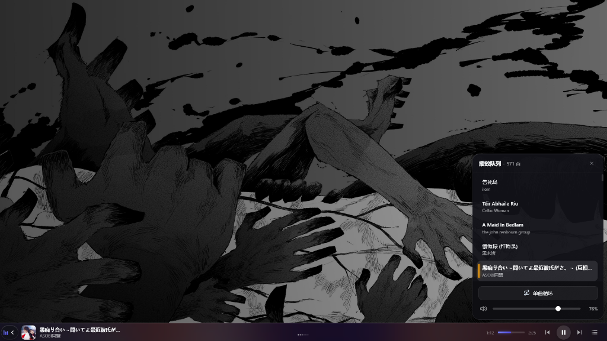
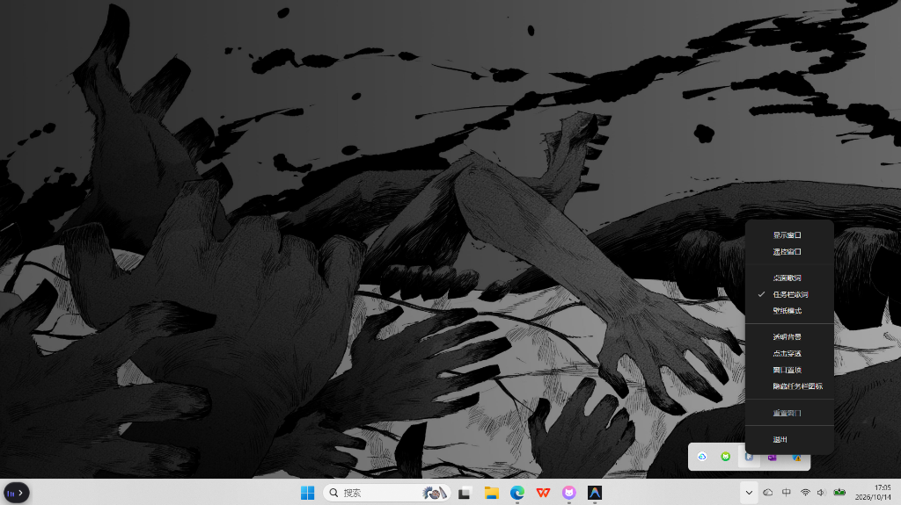

# 任务栏抽屉歌词 (Taskbar Lyrics Mod for Folia)

> 为 Windows 任务栏打造的沉浸式抽屉替换动态歌词模组（仅支持 Windows 平台）。基于 Folia / Folium 模组体系开发。

### 抽屉展开状态（完全覆盖任务栏、流体背景与快捷控制弹窗）

### 抽屉收起状态（最左侧常驻微型抽屉替换开关）

## 特性

- **抽屉式无缝替换**：在 Windows 任务栏最左侧提供常驻微型抽屉开关，点击后歌词栏从右向左覆盖任务栏，再次点击顺畅收回，彻底告别传统悬浮歌词遮挡工作区或误触穿透的问题。
- **点击任务栏不沉降**：采用原生 Windows 任务栏层级置顶守护，点击任务栏任意空白区域或切换应用，开关与抽屉绝不沉底或消失。
- **高保真流体封面背景**：高度复刻 Folia 官方歌词舞台质感，根据当前播放歌曲封面生成高斯模糊流体动态亚克力背景。
- **逐字平滑卡拉OK过渡**：支持 TTML / 逐字时间戳双行歌词（原文 + 翻译），字词级动态渐变扫光推进，智能处理中英西文间距。
- **常驻弹窗快捷控制面板**：右侧集成快捷功能弹窗，支持切歌、播放列表滚轮滚动直接点播、一键打开系统音量调节面板与随机换歌。

## 平台与兼容性

- **运行平台**：Windows 10 / 11（win32）
- **宿主版本要求**：Folia `>=0.7.19 <0.8.0`

## 安装方式

1. 下载模组发布包 `taskbar-lyrics.zip`；
2. 打开 Folia，进入左侧导航栏的「模组」面板；
3. 将 zip 压缩包直接拖入模组页面即可自动完成原子化安全安装，确认启用即可生效。

## 权限声明

- `runtime.playback`: 获取当前播放音轨的元数据（曲名、歌手、封面）、播放时间戳与歌词。
- `playback.control`: 抽屉按键与快捷菜单控制播放/暂停、上一曲/下一曲、进度拖拽与列表切换。

## 许可证

[MIT License](LICENSE)
