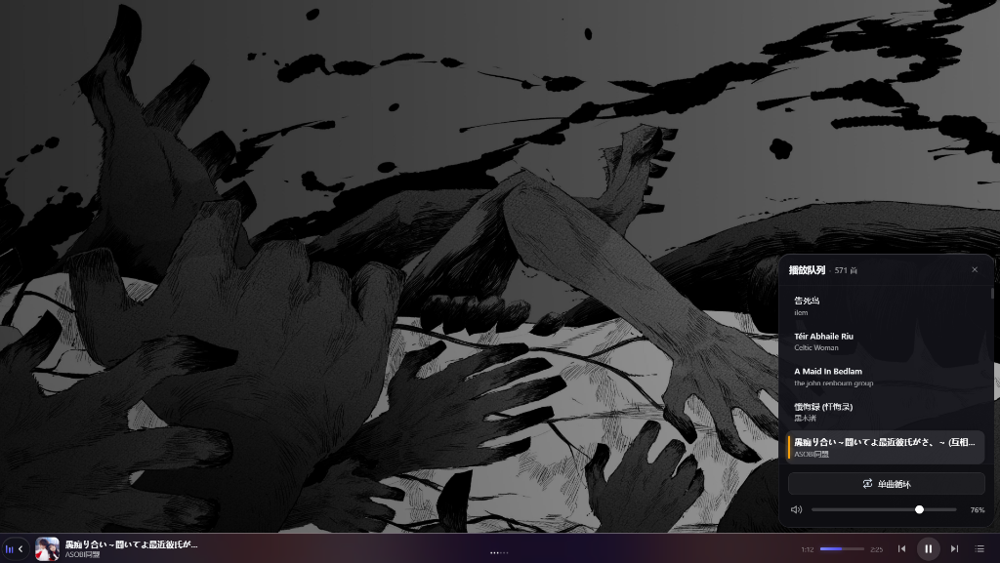
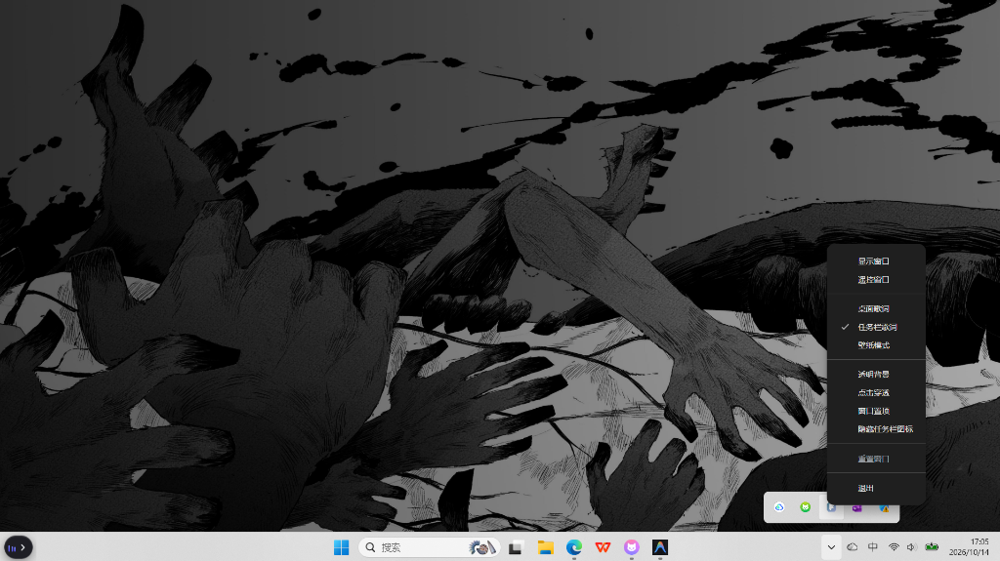

# 任务栏抽屉歌词 (Taskbar Lyrics Mod for Folia)

> 为 Windows 任务栏量身定制的沉浸式抽屉替换动态歌词模组（仅支持 Windows 平台）。基于 Folia / Folium 模组生态开发。

### 抽屉展开状态（完全覆盖任务栏、流体封面背景与多功能快捷控制弹窗）

### 抽屉收起状态（最左侧常驻微型抽屉替换开关）

---

## 核心特性

- **抽屉式无缝替换与悬停避让**：
  - **常规交互模式**：在 Windows 任务栏最左侧提供常驻微型抽屉开关，点击后歌词栏从右向左顺滑覆盖整段任务栏，支持直接点击控制与拖拽进度。
  - **鼠标悬停自动隐藏（Hover 隐藏）**：可在模组设置中开启，鼠标移入任务栏区域时歌词抽屉自动隐藏并穿透点击到底层原生 Windows 任务栏，鼠标移出任务栏后自动恢复显示。
- **多显示器切换与壁纸联动**：支持在主显示器、副显示器、指定编号显示器之间切换，或设置为自动跟随 Folia 壁纸模式所在显示器；快捷控制菜单底部也支持一键切换屏幕。
- **点击任务栏不沉降**：采用原生 Windows 任务栏层级置顶守护，点击任务栏任意空白区域、托盘图标或切换应用窗口时，开关与歌词抽屉始终稳定保持在任务栏最上层。
- **高保真流体封面背景**：深度复刻 Folia 官方歌词舞台质感，根据当前播放歌曲封面色彩实时生成高斯模糊流体动态亚克力背景。
- **逐字平滑卡拉OK过渡与后台防抖**：支持 TTML / 逐字时间戳双行歌词（原文 + 翻译），内置后台时钟直读与单调时间推进保护，即使 Folia 最小化在后台或系统高内存负载下，歌词与逐字扫光依然丝滑推进、不回弹抽动。
- **全功能快捷控制面板**：
  - **当前播放队列**：实时查看排队歌曲，支持滚轮平滑滚动、单击直接点播、一键打乱顺序与屏幕切换。
  - **歌单与收藏浏览**：直接在弹窗内浏览用户自建歌单及收藏歌单，支持每页 100 首的完整分页加载与翻页。
  - **实时歌曲过滤**：歌单内支持即时关键字过滤，优化输入法中文输入体验，快速锁定目标曲目。
  - **个性化推荐与私人电台**：支持推荐歌单直接进入浏览与播放，无缝接入 Personal FM 私人漫游模式。

---

## 平台与兼容性

- **运行平台**：Windows 10 / 11（win32）
- **宿主版本要求**：Folia `>=0.8.0`（已同步升级至 **Folium 2.1** 清单与接口规范）

---

## 安装方式

1. 下载模组发布包 `taskbar-lyrics.zip`；
2. 打开 Folia，进入左侧导航栏的「模组」面板；
3. 将 zip 压缩包直接拖入模组页面即可自动完成原子化安全安装，确认启用即可生效。

---

## 权限声明

本模组严格遵从 Folium 安全权限规范：

- `playback.read`：用于读取当前播放音轨的元数据（曲名、歌手、封面）、播放进度快照与歌词。
- `playback.control`：用于抽屉按键与快捷菜单控制播放/暂停、上一曲/下一曲、进度拖拽（Seek）、音量与静音调节、循环模式切换、队列打乱及单曲点播。
- `playback.queue`：用于在专辑点播时通过官方 `folium.playback.replaceQueue` 整表替换播放队列（支持宿主撤销并自动退出私人 FM）。

> 注：本模组在专辑浏览与曲目解析时还会使用无需额外权限的 `folium.omni`，它以你在 Folia 中登录的在线音源账号发起公开目录查询。

---

## 官方 API 覆盖与接口边界说明

本模组已同步 Folium 1.7 – 2.1 公开接口与规范，并经 `npm run folium:check mods/taskbar-lyrics` 静态审查通过：

### 1. 官方公开 API 覆盖
- **实时主题与字体（Folium 1.10）**：优先通过 `folium.theme.getCurrent()`（无需额外权限）读取屏幕当前主题与封面主题覆盖，配合 `theme.changed` 事件和 `folium.theme.resolveFontStack()` 解析字体栈；仅在 1.9 及更早宿主降级读取本地偏好。
- **播放状态、时钟与队列控制（Folium 1.5–1.7）**：`folium.playback.getState()` / `getQueue()` / `replaceQueue()` / `playSong()` / `playQueueItem()`，配合 `playback.songChanged`、`playback.stateChanged`、`playback.seeked`、`playback.queueChanged` 等事件驱动。
- **实时歌词**：初始化及恢复时直调 `folium.lyrics.getLines()`，运行时跟随官方 `lyrics.loaded` 事件。
- **在线目录服务（Folium 1.7）**：歌曲封面与时长通过 `folium.omni.describeSong()` 获取；在线专辑目录与曲目分页优先经 `folium.omni.resolveCollection()` 与 `folium.omni.getTracks()` 读取并保留有效 `ref`。
- **全局快捷键与命令面板（Folium 1.7）**：向 `folium.registries.commands` 注册支持 `globalShortcut: true` 的「展开/收起任务栏歌词」与「切换任务栏歌词显示器」命令，可在 Folia「设置 → 全局快捷键」中自由绑定系统级热键，不直接在主进程占用 `globalShortcut`。
- **双向低延迟推送与生命周期隔离（Folium 1.6–1.7）**：`client` 入口先过滤非 `main` 上下文（跳过透明视频导出窗口），并使用 `api.rpc.send` / `folium.rpc.on` 替代高频 `drainActions` IPC 轮询；主进程启动异步延迟创建窗口，避免 `activate` 阻塞超过 100ms 性能阈值。

### 2. 宿主尚无公开 API 的过渡降级能力
为保障任务栏直接点播本地音乐与个人歌单/漫游的完整体验，模组仅在官方 API 尚不提供的能力上保留受控降级路径：
- **本地曲库与离线歌单**：目前 Folium 2.1 尚未开放本地音乐库接口，模组只读 IndexedDB 本地表并按需通过受控回退建立播放队列；
- **用户个人歌单、收藏、推荐与私人 FM**：目前官方 `folium.omni` 仅开放公开曲库与专辑/歌手目录，个人数据能力留待后续 Folium 版本开放；
- **跟随壁纸屏幕与单曲歌词时间轴偏移**：因宿主尚未向非舞台类模组公开壁纸目标屏配置与歌词偏移字段，暂以只读配置与播放/歌词设置读取作为过渡。
在后续 Folium 版本提供对应公开接口后，本模组将第一时间无缝切入。

---

## 更新日志 (Changelog)

### v1.0.8
- **适配 Folia 0.8.0 与 Folium 2.1 规范及交互视觉优化**：
  - 清单升级为 `"folium": 2`、`"folia": ">=0.8.0"`，新增 `"contexts": ["main"]` 避免导出窗口加载 `client.mjs`；
  - 重构最左侧常驻抽屉开关按钮视觉逻辑：展开与收起状态下默认背景完全透明、无突兀底色边框，鼠标移入悬停时胶囊边缘与音律/箭头图案同步呈现柔和透光效果；
  - 修复关闭 Folia 主窗口（非托盘模式）时因任务栏与菜单窗口未随宿主关闭而阻塞 Electron `window-all-closed`、导致任务栏歌词残留及应用无法退出的问题（同时排除音源隐藏沙盒窗口干扰）；
  - 修复歌单在部分音源某分页不足 `100` 首（例如第 2 页 99 首导致合计 199 首）时因 `items.length < batchSize` 提前终止而截断的 bug，并兼容页码型音源短页边界推进与去重；
  - 修复 Folia `0.8.0` 单独拆库存储的 `FoliaPlaylistsDB`（含聚合歌单条目与 `folia-cover://` 本地封面）及历史 `KineticPlayerDB.api_cache` 读取；
  - 接入官方 `account.changed`（登录完成后自动刷新已打开的书库缓存）、`playback.failed`（播放失败即时停止歌词时钟外推）、`FoliumLine.renderHints.renderEndTime` 与 `folium.theme.resolveTranslationFontStack()`；
  - 修复从压缩包安装到用户目录后原生模块 `koffi` 无法从宿主路径解析的问题（增加 `require.main` 与资源目录回退解析）；
  - 修复 Folium `2.x` 下 `folium.host.folium.minor` 重置为 `1` 导致能力检测全部失效的问题（改为同时比较 `major` 与 `minor`），修复 `listProviders()` 读取 `.providerId`，并补充 `replacePlayQueue`、毫秒时长换算与异步 `isDisposed` 清理守护。

### v1.0.7
- **全面对齐 Folium 官方接口（至 Folium 1.10）与平台规范**：
  - 将权限声明从过期的 `runtime.playback` 更新为标准 `playback.read`、`playback.control`，并补充 `playback.queue` 与 `mod.json` 在线读取披露；
  - 主题读取与监听接入 **Folium 1.10 `folium.theme.getCurrent()`**（含 `minor >= 10` 兼容保护与冷启动后同步）、`theme.changed` 与 `folium.theme.resolveFontStack()`；
  - 歌词初始化与恢复全面接入 `folium.lyrics.getLines()` 与 `lyrics.loaded`，保留仅针对宿主页暂无公开接口的歌词时间轴偏移等受控回退；
  - 在线专辑目录与曲目分页优先接入 **`folium.omni.resolveCollection()` + `folium.omni.getTracks()`**，结合 `folium.omni.describeSong()`、`folium.omni.resolveSongs()` 与 **`folium.playback.replaceQueue()` / `playSong()` / `playQueueItem()`** 实现标准曲库点播与队列替换，并将内部 `omni` 退居为个人歌单/每日推荐/FM 等未开放接口的受控降级路径；
  - 命令面板与 **Folium 1.7 `globalShortcut: true` 系统级全局快捷键**接入「展开/收起任务栏歌词」与「切换任务栏歌词显示器」命令；
  - `client` 入口过滤非 `main` 上下文（跳过透明视频导出窗口），更新入口 JSDoc 至 `../folium`；主进程 `activate()` 延迟初始化窗口避免触发单次调用 `>= 100ms` 慢调用标记，Folium 1.7+ 下采用 `api.rpc.send` / `folium.rpc.on` 推送并在初始化排空后移除 200ms `drainActions` 轮询；
  - 完善全屏应用避让与竖屏任务栏适配，窗口标题统一为 `Folia Taskbar Lyrics`。

### v1.0.6 (2026-11-04)
- **新增 Hover 隐藏模式**：模组设置新增「鼠标交互模式」，支持保留当前常规交互或切换为「鼠标悬停自动隐藏（穿透操作原任务栏）」，移入任务栏自动隐藏并透传原生任务栏点击，移出自动恢复。
- **新增多显示器切换**：模组设置新增「目标显示器」选项（主屏 / 副屏 / 跟随壁纸显示器 / 指定屏幕 1~4），控制菜单底部栏新增一键切屏按钮，适应副屏壁纸与多屏工作流。
- **彻底修复切歌/Seek与后台歌词回弹**：基于官方 `playback.seeked`、`playback.songChanged` 事件与播放状态时钟门控，彻底解决切歌、进度拖拽与后台高负载时的歌词回退抽动；不触碰宿主私有 DOM，完全对齐官方审查标准。
- **大幅降低内存与 CPU 占用**：
  - 拆分任务栏快照与菜单快照，避免高频进度 IPC 克隆大歌单数据；
  - 剥离跨进程传输的原始冗余曲目/歌单对象，菜单关闭时自动释放缓存并在空闲 10 秒后销毁隐藏的菜单渲染进程；
  - 暂停、收起或悬停隐藏时自动挂起 60fps 渲染循环。

### v1.0.5 (2026-10-18)
- **Folium 规范全面对齐与清理**：
  - 宿主版本声明调整为 Folia `>=0.7.21 <0.8.0`，全面采用 Folium 1.6 标准设置项接口（`settings.get()` / `settings.onChange()`）；
  - 模组注销钩子规范化，避免重复执行销毁。

### v1.0.4 (2026-10-18)
- **控制弹窗大幅升级**：
  - 歌单歌曲支持分页加载（每页 100 首）与页码导航，支持显示数百首甚至数千首的长歌单全貌；
  - 优化歌单内实时过滤搜索输入法体验，解决单字中断问题；
  - 修复个性化推荐与私人电台入口的层级跳转与切歌逻辑；
  - 优化跨平台歌单歌曲点播与播放状态回显。

### v1.0.3 (2026-10-17)
- **音频同步与拖拽优化**：
  - 加入进度条拖拽 Seek 冷却锁，避免快速连拖导致音频时间与歌词错位；
  - 强化切歌时序防抖与歌词行重置。

### v1.0.2 (2026-10-15)
- **控制弹窗体验增强**：
  - 加入音量与静音调节防抖机制；
  - 增加循环模式切换（单曲循环、列表循环、顺序播放）。

### v1.0.1 (2026-10-14)
- **层级与视觉微调**：
  - 增强 Windows 任务栏 Z-order 守护稳定性；
  - 优化高斯模糊亚克力背景在浅色/深色主题下的自适应对比度。

### v1.0.0 (2026-10-14)
- 初始正式版本发布：Windows 任务栏抽屉歌词、流体亚克力封面、实时逐字歌词推进。

---

## 运行时与性能说明

- **轻量置顶守护**：Windows 任务栏 Z-order 守护采用 600ms 定时层级保活（单次耗时 < 0.05ms），配合鼠标移入交互即时提升，确保抽屉开关稳定覆盖在系统任务栏上层，空闲时 CPU 与电量占用趋近于零。
- **定时同步与推送**：渲染端常驻定时器每 200ms 校验播放时钟锚点，操作调度优先走 `folium.rpc.on` / `api.rpc.send` 双向推送（仅在 Folium 1.6 及更早宿主降级轮询 `drainActions`）；曲目、播放状态、音量、循环模式及队列刷新由 `playback.*Changed` 事件驱动推送。
- **音量设置合并**：拖动滑块时仅实时更新本地显示数值，在松手（`change`）时才向宿主触发 `setVolume` 避免高频落盘；滚轮调节配备 150ms 防抖合并。
- **合成器图层渲染**：亚克力流体背景使用 CSS 合成器层渲染，播放暂停时零多余重绘，对轻薄本与电池设备友好。

---

## 许可证

[MIT License](LICENSE)
