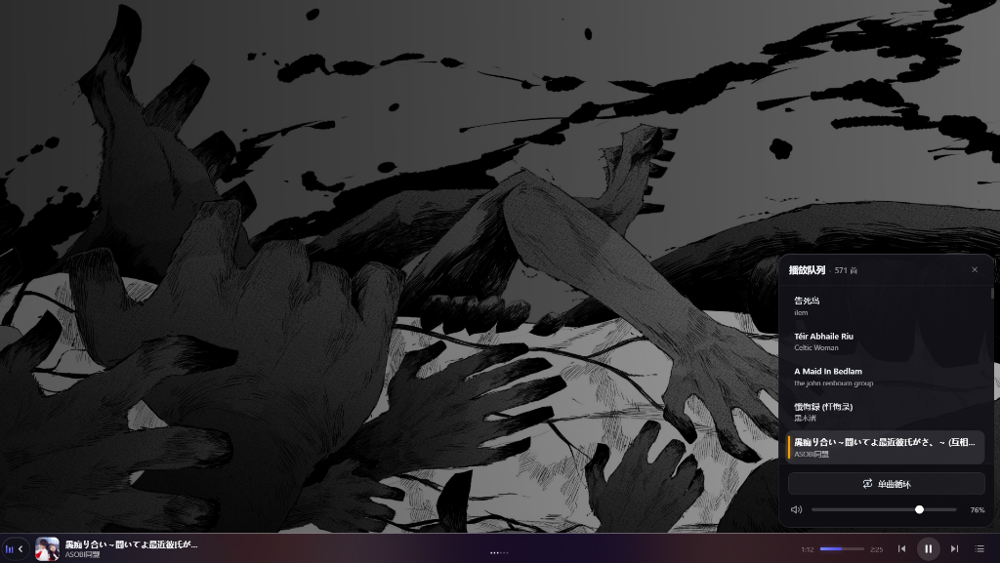
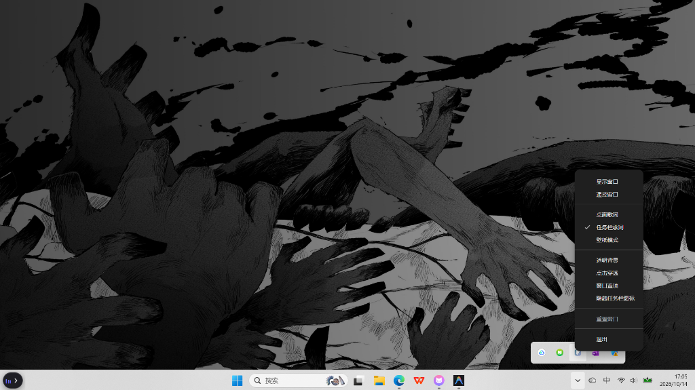

# 任务栏抽屉歌词 (Taskbar Lyrics Mod for Folia)

> 为 Windows 任务栏量身定制的沉浸式抽屉替换动态歌词模组（仅支持 Windows 平台）。基于 Folia / Folium 模组生态开发。

### 抽屉展开状态（完全覆盖任务栏、流体封面背景与多功能快捷控制弹窗）

### 抽屉收起状态（最左侧常驻微型抽屉替换开关）

---

## 核心特性

- **抽屉式无缝替换与悬停避让**：
  - **常规交互模式**：在 Windows 任务栏最左侧提供常驻微型抽屉开关，点击后歌词栏从右向左顺滑覆盖整段任务栏，支持直接点击控制与拖拽进度。
  - **鼠标悬停自动隐藏（Hover 隐藏）**：可在模组设置中开启，鼠标移入任务栏区域时歌词抽屉自动隐藏并穿透点击到底层原生 Windows 任务栏，鼠标移出任务栏后自动恢复显示。
- **多显示器切换与壁纸联动**：支持在主显示器、副显示器、指定编号显示器之间切换，或设置为自动跟随 Folia 壁纸模式所在显示器；快捷控制菜单底部也支持一键切换屏幕。
- **点击任务栏不沉降**：采用原生 Windows 任务栏层级置顶守护，点击任务栏任意空白区域、托盘图标或切换应用窗口时，开关与歌词抽屉始终稳定保持在任务栏最上层。
- **高保真流体封面背景**：深度复刻 Folia 官方歌词舞台质感，根据当前播放歌曲封面色彩实时生成高斯模糊流体动态亚克力背景。
- **逐字平滑卡拉OK过渡与后台防抖**：支持 TTML / 逐字时间戳双行歌词（原文 + 翻译），内置后台时钟直读与单调时间推进保护，即使 Folia 最小化在后台或系统高内存负载下，歌词与逐字扫光依然丝滑推进、不回弹抽动。
- **全功能快捷控制面板**：
  - **当前播放队列**：实时查看排队歌曲，支持滚轮平滑滚动、单击直接点播、一键打乱顺序与屏幕切换。
  - **歌单与收藏浏览**：直接在弹窗内浏览用户自建歌单及收藏歌单，支持每页 100 首的完整分页加载与翻页。
  - **实时歌曲过滤**：歌单内支持即时关键字过滤，优化输入法中文输入体验，快速锁定目标曲目。
  - **个性化推荐与私人电台**：支持推荐歌单直接进入浏览与播放，无缝接入 Personal FM 私人漫游模式。

---

## 平台与兼容性

- **运行平台**：Windows 10 / 11（win32）
- **宿主版本要求**：Folia `>=0.7.21 <0.8.0`（基于 Folium 1.8 标准规范）

---

## 安装方式

1. 下载模组发布包 `taskbar-lyrics.zip`；
2. 打开 Folia，进入左侧导航栏的「模组」面板；
3. 将 zip 压缩包直接拖入模组页面即可自动完成原子化安全安装，确认启用即可生效。

---

## 权限声明

本模组严格遵从 Folium 安全权限规范：

- `playback.read`：用于读取当前播放音轨的元数据（曲名、歌手、封面）、播放进度快照与歌词。
- `playback.control`：用于抽屉按键与快捷菜单控制播放/暂停、上一曲/下一曲、进度拖拽（Seek）、音量与静音调节、循环模式切换、队列打乱及歌单曲目点播。

---

## 官方 API 覆盖与接口边界说明

本模组现已全面切换至 Folium 官方公开 API，并经 `check.mjs` 静态审查 0 警告通过：

### 1. 100% 官方公开 API 覆盖
- **播放状态与时钟**：`folium.playback.getState()`，配合 `playback.songChanged`、`playback.stateChanged`、`playback.seeked`、`playback.likeChanged` 事件驱动；
- **实时歌词**：初始化及恢复时直调 `folium.lyrics.getLines()`，运行时跟随官方 `lyrics.loaded` 事件；
- **外观主题**：全局监听 `folium.events.on('theme.changed')`，并通过 `folium.theme.resolveFontStack()` 自动解析字体族；
- **在线服务**：通过官方 `folium.omni`（`describeSong`、`listProviders` 等）提取封面与元数据；
- **播放控制**：点播曲目优先调用 `folium.playback.playSong(song)` 与 `folium.playback.playQueueItem(idx)`。

### 2. 宿主尚无公开 API 的过渡降级能力
为保障任务栏直接点播本地音乐与私人漫游的完整体验，模组保留了受控降级路径：
- **本地曲库与离线歌单**：目前 Folium 尚未开放本地音乐库接口（`folium.library`），模组通过安全只读 IndexedDB 本地表浏览本地曲目，若无 song ref 则安全尝试宿主播放队列，若宿主环境不可用则优雅提示，绝不抛出未捕获异常；
- **用户自建与收藏在线歌单**：目前官方 `folium.omni` 仅开放公共资源检索，尚未提供个人歌单读取接口；
- **跟随壁纸屏幕**：因 Electron 主进程未暴露壁纸目标屏 IPC，模组对 `userData/config.json` 进行只读解析并配备主显示器安全降级。
在后续 Folium 版本提供对应公开接口后，本模组将第一时间无缝切入。

---

## 更新日志 (Changelog)

### v1.0.7 (2026-11-05)
- **全面对齐官方公开 API 规范（清理私有依赖，通过静态审查 0 警告）**：
  - 将权限声明从过期的 `runtime.playback` 更新为标准 `playback.read`；
  - 歌词初始化与恢复全面接入官方公开的 `folium.lyrics.getLines()` 与 `lyrics.loaded`；
  - 彻底移除对私有 `themeSettings`、`lyricSettings` 及 `playback` store 的读写与订阅；
  - 主题监听与字体族解析全面迁移至 `theme.changed` 与 `folium.theme.resolveFontStack()`，彻底移除底层缓存读取；
  - 模组曲目点播优先调用官方 `folium.playback.playSong()`（通过有效 session ref）与 `folium.playback.playQueueItem()`；
  - `getOmni()` 统一收敛至官方稳定扩展接口 `folium.omni`；
  - 消除全部 `folium.internals` 静态告警，对未开放公开 API 的本地库特性建立安全隔离与防御性降级。

### v1.0.6 (2026-11-04)
- **新增 Hover 隐藏模式**：模组设置新增「鼠标交互模式」，支持保留当前常规交互或切换为「鼠标悬停自动隐藏（穿透操作原任务栏）」，移入任务栏自动隐藏并透传原生任务栏点击，移出自动恢复。
- **新增多显示器切换**：模组设置新增「目标显示器」选项（主屏 / 副屏 / 跟随壁纸显示器 / 指定屏幕 1~4），控制菜单底部栏新增一键切屏按钮，适应副屏壁纸与多屏工作流。
- **彻底修复切歌/Seek与后台歌词回弹**：基于官方 `playback.seeked`、`playback.songChanged` 事件与播放状态时钟门控，彻底解决切歌、进度拖拽与后台高负载时的歌词回退抽动；不触碰宿主私有 DOM，完全对齐官方审查标准。
- **大幅降低内存与 CPU 占用**：
  - 拆分任务栏快照与菜单快照，避免高频进度 IPC 克隆大歌单数据；
  - 剥离跨进程传输的原始冗余曲目/歌单对象，菜单关闭时自动释放缓存并在空闲 30 秒后销毁隐藏的菜单渲染进程；
  - 暂停、收起或悬停隐藏时自动挂起 60fps 渲染循环。

### v1.0.5 (2026-10-18)
- **Folium 规范全面对齐与清理**：
  - 宿主版本声明调整为 Folia `>=0.7.21 <0.8.0`，全面采用 Folium 1.6 标准设置项接口（`settings.get()` / `settings.onChange()`）；
  - 模组注销钩子规范化，避免重复执行销毁。

### v1.0.4 (2026-10-18)
- **控制弹窗大幅升级**：
  - 歌单歌曲支持分页加载（每页 100 首）与页码导航，支持显示数百首甚至数千首的长歌单全貌；
  - 优化歌单内实时过滤搜索输入法体验，解决单字中断问题；
  - 修复个性化推荐与私人电台入口的层级跳转与切歌逻辑；
  - 优化跨平台歌单歌曲点播与播放状态回显。

### v1.0.3 (2026-10-17)
- **音频同步与拖拽优化**：
  - 加入进度条拖拽 Seek 冷却锁，避免快速连拖导致音频时间与歌词错位；
  - 强化切歌时序防抖与歌词行重置。

### v1.0.2 (2026-10-15)
- **控制弹窗体验增强**：
  - 加入音量与静音调节防抖机制；
  - 增加循环模式切换（单曲循环、列表循环、顺序播放）。

### v1.0.1 (2026-10-14)
- **层级与视觉微调**：
  - 增强 Windows 任务栏 Z-order 守护稳定性；
  - 优化高斯模糊亚克力背景在浅色/深色主题下的自适应对比度。

### v1.0.0 (2026-10-14)
- 初始正式版本发布：Windows 任务栏抽屉歌词、流体亚克力封面、实时逐字歌词推进。

---

## 运行时与性能说明

- **轻量置顶守护**：Windows 任务栏 Z-order 守护采用 1000ms 定时层级保活（单次耗时 < 0.05ms），配合鼠标移入交互即时提升，确保抽屉开关稳定覆盖在系统任务栏上层，空闲时 CPU 与电量占用趋近于零。
- **定时同步与排空**：渲染端常驻定时器每 250ms 调用一次 `folium.playback.getState()` 同步播放进度差值，并排空 `drainActions` 用户操作队列；曲目、播放状态、音量、循环模式及队列刷新则完全由 `playback.*Changed` 事件驱动推送。
- **音量设置合并**：拖动滑块时仅实时更新本地显示数值，在松手（`change`）时才向宿主触发 `setVolume` 避免高频落盘；滚轮调节配备 150ms 防抖合并。
- **合成器图层渲染**：亚克力流体背景使用 CSS 合成器层渲染，播放暂停时零多余重绘，对轻薄本与电池设备友好。

---

## 许可证

[MIT License](LICENSE)

